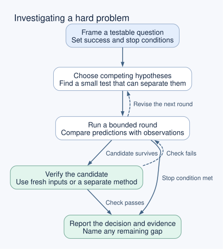

# Attack Hard Problems

A Codex skill for investigating problems where several explanations fit the evidence, or where the path to a solution is still unclear. Give it the question, the evidence you have, and the constraints. It will design checks that can distinguish the leading hypotheses, then report what survived and where the evidence runs out.

Use it for an intermittent failure, a research claim that needs a counterexample, or a design decision whose tradeoffs you can test. For a routine change with a known procedure, give Codex the task directly.

## Install in Codex

For use across your projects, run these commands in a terminal.

```bash
mkdir -p ~/.agents/skills
git clone https://github.com/jdlnolen/attack-hard-problems.git ~/.agents/skills/attack-hard-problems
```

For use in one repository, place the complete skill directory at `.agents/skills/attack-hard-problems/` in that repository. If you already installed an earlier copy, update that folder to avoid duplicate skill entries. Open a Codex chat and type `$` to find **Attack Hard Problems**. Restart Codex if the skill is missing. [Codex skills documentation](https://developers.openai.com/codex/skills)

The skill works with one agent. Individual investigations may need tools or data from your project. The included exercise needs only Python 3.

## Try it

Copy this into Codex from the project you want to investigate.

```text
Use $attack-hard-problems to investigate [question or observed symptom].
Here is what I observed: [logs, files, or measurements].
Success means [observable result]. Keep [constraints] fixed.
Start with [time or experiment limit] and show the evidence behind your conclusion.
```

Ask for **a plan only** to receive a map of what to test and why. Ask it to **investigate** when it should run the checks within the scope and access you provide. If your environment supports subagents and you want parallel work, ask to give them distinct hypotheses or independent checks.

[Try the worked example](references/worked-example.md) with a small Python cache. You can run the same investigation yourself, then compare the results against the walkthrough. It shows how to shrink the problem, rule out a plausible explanation, and check the proposed repair with request sequences held out of discovery.

## How it works



Look for these in the result.

- The current decision and the observations that support it.
- A test that would have failed if the leading explanation were wrong.
- The assumptions under which a small experiment applies to the original problem.
- A reproduction or independent check on the original target, or a specific account of the evidence still needed.

See the [skill instructions](SKILL.md) and the [optional delegation guide](references/agent-topology.md).

## Origin

The skill adapts OpenAI's approach to the Navier–Stokes problem. Separate agent groups pursued proofs and disproofs. A result on the related Euler equations helped the team decide where to concentrate its efforts. The groups shared intermediate findings, and the resulting proof was formalized and checked in Lean. This skill brings those steps to investigations that one Codex agent or a small group can run. [OpenAI, *On the Navier–Stokes Millennium Prize Problem*, September 8, 2026](https://openai.com/index/navier-stokes-solution/)

## License

[MIT](LICENSE)
