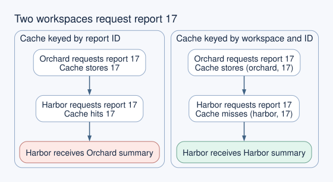

# Worked example: a report cache returns the wrong workspace's data

A report service sometimes returns a label from another workspace. The [Python fixture](fixtures/report_cache.py) uses fictional data and keeps its cache in memory. The rule is simple: a request must return the label for its workspace and report ID, or `None` if that pair is missing.

## Reproduce the symptom

Run this from the root of the downloaded skill.

```bash
python3 references/fixtures/report_cache.py
```

```text
orchard/17 -> Orchard summary
harbor/17 -> Orchard summary
harbor/24 -> Harbor inventory
```

To try the skill yourself, copy `references/fixtures/report_cache.py` into an empty working folder and open Codex there. Keep the walkthrough collapsed until your run finishes.

```text
Use $attack-hard-problems to investigate report_cache.py. With one
ReportService instance, orchard/17 returns "Orchard summary", then
harbor/17 also returns "Orchard summary". Each workspace must get its own
report, or None for a missing report. Use only local Python 3 and the supplied
file. Propose a minimal repair and test it in a temporary copy. Preserve the
fixture. Use one round to distinguish plausible causes, then verify the
proposed repair with a separate check on fresh request sequences.
```

<details>
<summary>Open the walkthrough</summary>

## Frame the decision

Can a lookup return the correct value for each `(workspace, report_id)` regardless of request order? A single wrong label or missing result falsifies this for the fixture. Reserve report ID `42` and the missing-report sequence for verification.

## Run one round

| Explanation | Prediction | Observation |
| --- | --- | --- |
| The data or source lookup ignores the workspace. | `harbor/17` can return the wrong value on its first request to a fresh service. | A fresh service returns `Harbor summary` for `harbor/17`. The data contains both labels. |
| The cache reuses a report ID across workspaces. | With a shared cache, the second workspace gets the first workspace's label. Switching the order switches the wrong label. | Orchard then Harbor returns the Orchard label twice. Harbor then Orchard returns the Harbor label twice. |

The proxy uses two records with the same ID and one service instance. It preserves the suspected collision and removes the other reports from the check. Reversing the requests makes the incorrect result follow the cache's first entry.



## Repair and verify

In a scratch copy, replace the body of `get_report` with the following. The same key now identifies the record in the source and in the cache.

```python
key = (workspace, report_id)
if key not in self.cache:
    self.cache[key] = self.reports.get(key)
return self.cache[key]
```

From the folder containing the scratch `report_cache.py`, run this check. The expected labels come from the fixture's input data. The earlier reproducer's output played no part in setting them.

```bash
python3 -B - <<'PY'
from report_cache import REPORTS, ReportService

cases = [
    [("harbor", 42, "Harbor forecast"), ("orchard", 42, "Orchard forecast"),
     ("harbor", 42, "Harbor forecast")],
    [("orchard", 24, None), ("harbor", 24, "Harbor inventory")],
]
failures = []
for sequence in cases:
    service = ReportService(REPORTS)
    for workspace, report_id, expected in sequence:
        actual = service.get_report(workspace, report_id)
        if actual != expected:
            failures.append((workspace, report_id, expected, actual))

assert not failures, failures
print("Passed 5 lookups across 2 request sequences")
PY
```

The original fails the Orchard request for ID `42` and the Harbor request for ID `24`. The repair passes both sequences. Together with the original replay, these checks support the diagnosis and repair for this in-memory implementation. A deployed service would need a reproduction through its own request and cache layers.

## Run the same checks with one agent or several

In a solo run, have Codex test the fresh lookup first, then reverse the request order and check the proposed repair against the reserved sequences.

If your host supports delegation and you authorize it, give one branch the fresh lookup and another the request-order test. Give both the workspace isolation rule and ask for the exact requests and outputs. Once they return, hand the original rule and reserved sequences to a verifier. The coordinator compares all results and reports the scope of the repair. See the [delegation guide](agent-topology.md).

</details>
